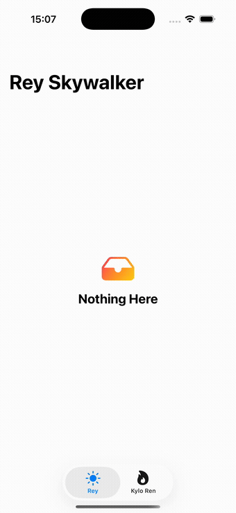

# ScreenStates Demo

<p align="center">
  
</p>

A runnable iOS app showing the library on two screens, built with two
different paradigms — and, since a plain "Articles" list is a bit dry,
themed around two *Star Wars* characters instead:

- **Rey Skywalker** — SwiftUI, using `ScreenStateStore` + `ScreenStateView`,
  listing facts about her with a golden-lightsaber accent.
- **Kylo Ren** — UIKit, using `ScreenStateStore` + `ScreenStateContainerView`,
  wrapped for the tab bar with `UIViewControllerRepresentable`, with a
  red-lightsaber accent. No character artwork is used anywhere — just SF
  Symbols and text, to stay clear of Lucasfilm/Disney-owned imagery.

Both screens call a simulated, flaky `ReyFactsService` / `KyloRenFactsService`
through the library's real `loadCollection(_:)` API every couple of seconds,
so opening either tab cycles through **Loading → Empty → Data → Error →
Data** entirely on its own — no backend required. The Retry button on the
Error placeholder calls the exact same reload path. The app also switches
between the two tabs on its own every 6 seconds, so the whole thing is
watchable hands-off — which is how the GIF above was recorded.

## Running it

Open `ScreenStatesDemo.xcodeproj` in Xcode and run the `ScreenStatesDemo`
scheme on any iOS 17+ simulator or device. It depends on the `ScreenStates`
package one directory up via a local Swift Package reference — no external
dependencies to fetch.

## UI tests

`ScreenStatesDemoUITests` drives the real, built app through all four
`ScreenState` cases — an integration-level check the package's own unit
suite can't give you, since that suite never assembles `ScreenStateStore`
and the default placeholders into a real screen inside a real app. It
rides the Rey tab's real auto-cycle rather than forcing a state, polling
for all four to occur at least once within one generous window instead of
assuming a strict order (launch/warm-up time before the test starts
polling is real but unpredictable). Run it as part of the `ScreenStatesDemo`
scheme's test action:

```sh
UDID=$(xcrun simctl list devices available -j | jq -r '[.devices[][] | select(.name | test("iPhone"))][0].udid')
xcodebuild test -project ScreenStatesDemo.xcodeproj -scheme ScreenStatesDemo -destination "platform=iOS Simulator,id=$UDID"
```

Launching with the `-UITesting` argument (which the test does for you)
disables the app's own hands-off auto-tab-switching, so the test isn't
carried away from the tab it's watching mid-cycle.

## Regenerating the project

The `.xcodeproj` is checked in for convenience, but it's generated from
[`project.yml`](project.yml) with [XcodeGen](https://github.com/yonaskolb/XcodeGen):

```sh
brew install xcodegen   # if you don't have it
cd Demo/ScreenStatesDemo
xcodegen generate
```
